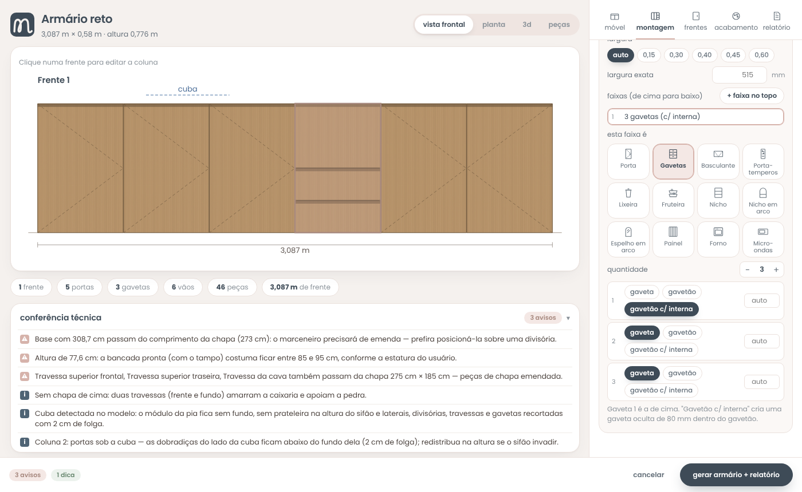

# planê.mob · marcenaria paramétrica para SketchUp

Plugin para **SketchUp 2026 (Windows)** que gera marcenaria completa a partir de um volume: caixaria, portas, gavetas, aramados, lixeira, nichos, ferragens modeladas, conferência técnica, lista de peças, plano de corte e relatório executivo — tudo separado em componentes, como uma maquete de marcenaria de verdade.

Identidade visual da família **planê** (areia, grafite e rosé · Poppins + The Seasons).



## Instalar

1. Baixe [`dist/marce.rbz`](dist/marce.rbz).
2. No SketchUp: **Extensões → Gerenciador de Extensões → Instalar extensão** e escolha o `marce.rbz`.
3. Aparece a barra **planê.mob** e o menu **Extensões → planê.mob**.

## Atualizar (sem reinstalar)

Instale o `.rbz` **uma vez**. Depois, quando sair versão nova, é só apertar **Atualizar planê.mob** — na barra de ferramentas, em **Extensões → planê.mob**, ou no rodapé da janela (aparece "nova versão · atualizar" em rosé quando tem novidade). A planê.mob baixa do GitHub, confere a assinatura do arquivo, instala por cima e recarrega na hora, sem reiniciar o SketchUp. Ao abrir o SketchUp ele também avisa sozinho (uma vez por dia).

Para lançar uma versão: troque `VERSAO` em `src/marce/versao.rb`, escreva as novidades no topo do `CHANGELOG.md`, rode `./tools/empacotar.sh` (gera `dist/marce.rbz` e `versao.json`), faça commit e push.

## Usar

1. Modele uma **caixa (volume)** onde o móvel vai ficar e selecione (grupo, componente ou faces).
   - A **frente** é o lado comprido voltado para a câmera.
   - Se houver uma **cuba/pia** no modelo sobre o volume (componente com "cuba" ou "pia" no nome), ela é detectada.
2. Clique em **Novo móvel** (ou botão direito → planê.mob → Criar móvel neste volume).
3. Configure na janela (clique em qualquer **?** para ver como usar a opção, ou no **?** do topo para o passo a passo):
   - **Móvel** — tipo (balcão, aéreo, torre, gaveteiro, guarda-roupa, estante, gabinete, personalizado), ambiente (seco, cozinha, banheiro, lavanderia), base (rodapé recuado, suspenso, pés), roda-teto, topo (travessas ou chapa), fundo, espessuras, cuba e tampo, chapa.
   - **Montagem** — largura máxima de porta, divisórias (cada porta / cada par / nenhuma), prateleiras por vão. **Clique numa frente** na vista frontal para transformar a coluna em porta, gavetas (com gavetão e gaveta interna oculta), basculante, porta-temperos, lixeira, fruteira, nicho, nicho em arco, espelho em arco, painel, forno ou micro-ondas. Dá para empilhar faixas (ex.: gavetas embaixo, forno, micro, porta em cima).
   - **Frentes** — puxador (cava 45° usinada, perfil, passante, alça, toque, sem), posição, sobreposta/embutida, folgas, veio, corrediça telescópica/oculta.
   - **Acabamento** — padrões por marca (Arauco, Berneck, Duratex, Guararapes, genéricos), busca, padrão próprio, MDF interno branco, escala da textura. "Salvar como meu padrão" guarda tudo para os próximos móveis.
   - **Relatório** — gera o relatório executivo junto com o móvel.
4. **Gerar armário**. O volume fica escondido (tag `planê.mob · volumes`) e o móvel é criado no lugar.

Depois:

- **Editar móvel** (selecione o móvel): reabre a janela com tudo como estava e atualiza no mesmo lugar.
- **Abrir/fechar portas e gavetas**: clique numa porta, gaveta ou aramado para animar a abertura. **Abrir tudo / Fechar tudo** no menu.
- **Relatório executivo**: salva um HTML na pasta `planê.mob - relatórios` ao lado do .skp e abre no navegador (Imprimir → Salvar como PDF). As perspectivas saem do próprio modelo.
- **Lista de peças do projeto (CSV)**: soma as peças de todos os móveis da planê.mob no modelo.

## O que vai no modelo

- Grupo do móvel com subgrupos por porta/gaveta/aramado (a gaveta interna fica dentro do gavetão) — é isso que permite abrir e fechar.
- Cada peça é um **componente** com nome, material e atributos de corte (funciona com o OpenCutList).
- Tags: `planê.mob · caixaria`, `frentes`, `gavetas`, `fundos`, `ferragens`, `rodapé e roda-teto`, `tampo`.
- Materiais `planê.mob · …` com textura de veio tingida na cor do padrão — troque a textura do material no SketchUp e todas as peças atualizam.
- Dobradiças (canecos), corrediças, cestos aramados, cesto de lixeira, tubo de cabideiro, puxadores, pés e espelho modelados.

## Regras de marcenaria aplicadas (conferência técnica)

- Peças que passam da chapa (2750 × 1850, refilo de 10 mm → 273 cm úteis), com opção de emendar sobre divisória.
- Topo em travessas (frente e fundo) sob tampo; travessa da cava e travessas entre gavetas com puxador cava.
- Cuba: módulo sem fundo e sem prateleira na altura do sifão; recortes com 2 cm de folga; dobradiças abaixo do fundo da cuba.
- Dobradiça reta (lateral externa), curva (divisória compartilhada) e super curva (embutida); quantidade pela altura da porta (2/3/4/5).
- Portas acima de 60 cm, portas muito altas (empeno), basculantes pesados, prateleiras com vão > 80 cm, frentes de gaveta baixas.
- Corrediças pelo comprimento comercial que cabe na profundidade útil (250–600 mm); telescópica 12,5 mm/lado, oculta 5 mm/lado.
- Gaveta interna oculta (80 mm, recuada 15 mm, corrediças próprias), lixeira com litros calculados, porta-temperos.
- Nichos de forno (56–57 × 59–60 cm) e micro-ondas; cabideiro (altura e profundidade úteis); altura da bancada (85–95 cm); aéreo (profundidade e distância da bancada).
- Divisórias "nenhuma" com 3+ portas: erro (porta do meio sem onde fixar dobradiça).

## Desenvolvimento

```
src/marce.rb            carregador da extensão
src/marce/              Ruby (menus, volume, construtor, abrir/fechar, exportar, janela)
src/marce/ui/           janela HTML: engine.js (motor), render.js, report.js, app.js, catalogo.js, nesting.js
test/                   testes (motor, janela, ponte JS↔Ruby, Ruby com API simulada)
tools/                  empacotar .rbz, gerar ícones
```

- Prévia sem SketchUp: abra `src/marce/ui/index.html` no navegador (modo demonstração).
- Testes: `npm test` (motor + Ruby simulado) e `npm run test:ui` (janela no Chromium).
- Pacote: `./tools/empacotar.sh` → `dist/marce.rbz` + `versao.json`.

As cores do catálogo são aproximadas — confira sempre o mostruário do fornecedor. A fonte The Seasons é de uso licenciado da Laís; Poppins é livre (OFL).
